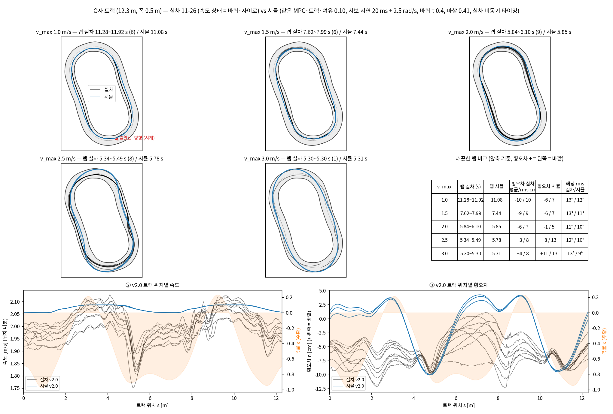

# 2026-11-27 O자 트랙 실차 ↔ 시뮬 (메인 PC)

움짤 (v2.0, 같은 출발선 동시 출발): `figs/otrack_v2.0.gif`. 그림 스크립트 `figs/make_otrack_fig.py`.

## 시뮬 설정

- 트랙 `o_track` (main `lab_map/data/tracks/o_track` 복사, 12.28 m, 폭 0.5, 시계 방향), `wall_margin 0.10`
- MPC: v2 MpccController + 젯슨 hmpc.yaml 타이어·q_delta (`tools/analysis/jetson_hmpc_params.yaml`)
- 차: 마찰 0.41, 바퀴 τ 0.4, **서보 지연 20 ms + 각속도 상한 2.5 rad/s** (새 `lowlevel.yaml`)
- 속도 상태: `--realtime --estimator gyro --vy zero` (실차 sensor 모드와 같음: vx 바퀴, r 자이로, 뒤축 vy 0)
- 실차: 11-26 연구실 mocap sensor 주행, 멈칫 없는 랩만. 위치는 둘 다 앞축

## 서보 모델 고르기 (개루프 재생, 1 s 뒤 위치·헤딩)

| 설정 | 11-10 (612 창) | 11-26 (1473 창) |
|---|---|---|
| τ 0.03 (전) | 5.0 cm 3.8° | 6.4 cm 3.3° |
| τ 0.13 (MPC 모델) | 8.9 cm 7.9° | 6.8 cm 6.1° |
| **지연 20 ms + 2.5 rad/s** | 5.6 cm 4.0° | 6.5 cm 3.4° |
| 40 ms + 2.2 | 6.2 cm 5.1° | 6.4 cm 3.9° |
| 60 ms + 2.2 | 6.5 cm 6.1° | 6.4 cm 4.5° |

- 거치대 계단 (젯슨) 은 지연 40~60 ms + 2.0~2.5 rad/s. 땅 위 재생은 지연이 20 ms 를 넘으면 나빠진다 → 상한은 거치대, 지연은 20 ms

## 결과

| v_max | 랩 실차 | 랩 시뮬 | 횡오차 실차 평균/rms | 시뮬 | 헤딩 rms 실차/시뮬 | 조향 한계 비율 실차/시뮬 |
|---|---|---|---|---|---|---|
| 1.0 | 11.28~11.92 | 11.08 | −10 / 10 cm | −6 / 7 | 13° / 12° | 17~21 % / 2 % |
| 1.5 | 7.62~7.99 | 7.44 | −9 / 9 | −6 / 7 | 13° / 11° | 27~29 % / 8 % |
| 2.0 | 5.84~6.10 | 5.85 | −6 / 7 | −1 / 5 | 11° / 10° | 44~45 % / 40 % |
| 2.5 | 5.34~5.49 | 5.78 | +3 / 8 | +8 / 13 | 12° / 10° | 55 % / 63 % |
| 3.0 | 5.30 (1 랩) | 5.31 | +4 / 8 | +11 / 13 | 13° / 9° | 63 % / 51 % |

- 맞는 것: 궤적 모양, v1.0~2.0·3.0 랩, 헤딩, 횡오차가 저속 안쪽 → 고속 바깥으로 바뀌는 경향
- 다른 것
  1. 실차가 트랙 전체 (직선 포함) 에서 5~7 cm 오른쪽 (안쪽) → 좌표 (마커 보정·센터라인) 의심
  2. 실차는 코너 입구 s ≈ 5.2 m 에서 1.75 m/s 까지 감속 (kf 모드에선 0.8 까지, 매 랩). 시뮬은 거의 일정
  3. 저속 조향 한계 비율 실차 20 % vs 시뮬 2 %
  4. v2.5 시뮬이 0.3~0.4 s 느리고 바깥으로 크게 돈다
- 시뮬 kf ↔ sensor: 시뮬에선 차이가 없다 (v2.0 kf 5.72 s, sensor 5.85 s). 실차의 kf 코너 입구 감속은 시뮬 KF 모델로 재현되지 않는다
