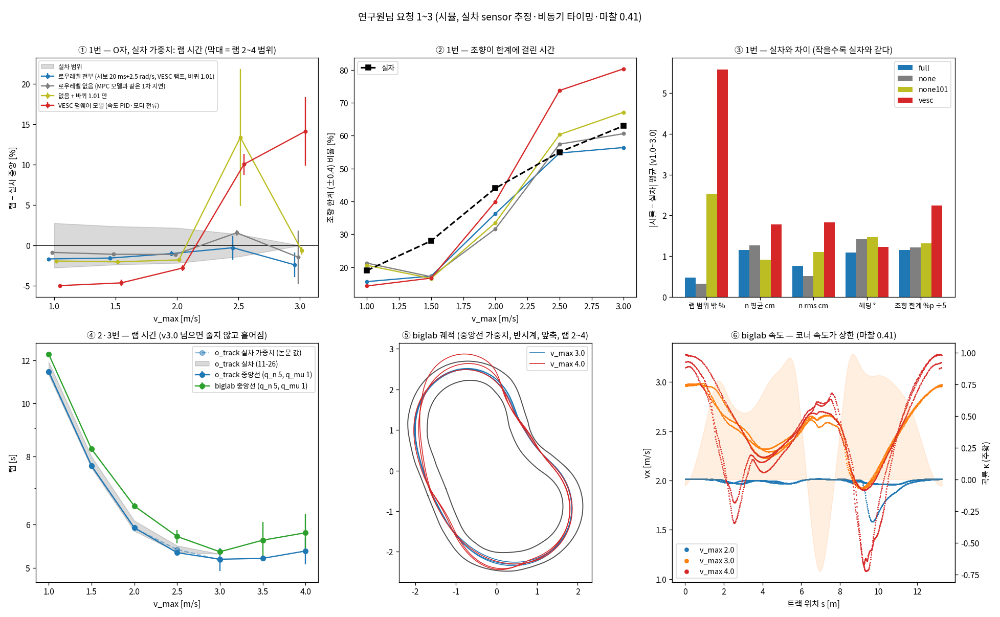

# 2026-11-27 서용화 연구원님 요청 1~3 (시뮬, 메인 PC)

공통: 실차 sensor 추정 (`--realtime --estimator gyro --vy zero`), 마찰 0.41, 젯슨 타이어·q_delta 3, wall_margin 0.10, 4 랩 (랩 2~4 평가). 위치는 앞축.
그림 스크립트 `figs/make_req_fig.py`. 가중치 파일: 실차 (논문 값) `tools/analysis/jetson_hmpc_params.yaml`, 중앙선 `tools/analysis/center_params.yaml`.

## 1. 로우레벨을 시뮬에 넣는 것이 실차와 더 맞나 (O자, 실차 가중치 = 11-26 실차와 같은 조건)

| 조건 | 내용 |
|---|---|
| full | `lowlevel.yaml` (서보 지연 20 ms + 2.5 rad/s, VESC 가속 램프 5.23, 감속 2.5) + 바퀴 실제/명령 1.01 |
| none | `--lowlevel none` — MPC 모델과 같은 1 차 지연만 (서보 τ 0.13, 바퀴 τ 0.4, 감속 2.5), 바퀴 1.0 |
| none101 | none + 바퀴 1.01 |
| vesc | `--wheel vesc` — VESC 펌웨어 속도 PID·모터 전류 모델 (env/drivetrain.py), 서보는 lowlevel.yaml |

v1.0~3.0 평균 |시뮬 − 실차| (11-26 실차 표 기준)

| 조건 | 랩 (실차 범위 밖 %) | n 평균 cm | n rms cm | 헤딩 ° | 조향 한계 %p |
|---|---|---|---|---|---|
| **full** | 0.5 | 1.2 | 0.8 | **1.1** | **5.8** |
| none | **0.3** | 1.3 | **0.5** | 1.4 | 6.1 |
| none101 | 2.5 | **0.9** | 1.1 | 1.5 | 6.6 |
| vesc | 5.6 | 1.8 | 1.8 | 1.2 | 11.2 |

- **폐루프 랩 지표로는 full 과 none 이 거의 같다.** MPC 가 피드백으로 로우레벨 차이를 덮는다. full 이 헤딩·조향 한계에서 조금 낫고, none 은 랩·n rms 에서 조금 낫다
- **개루프 (1 s 예측) 로는 로우레벨이 확실히 낫다** (이전 재생 결과, 같은 /drive 를 넣고 1 s 뒤 비교):
  서보 τ 0.13 (= none) 11-10 8.9 cm·7.9°, 11-26 6.8 cm·6.1° → 로우레벨 서보 5.6 cm·4.0°, 6.5 cm·3.4°. 헤딩 오차가 절반
- VESC 펌웨어 모델은 오히려 나빠진다 (랩 −5 %, 고속 조향 한계 과다) → 지금 값으로는 쓰지 않는다
- 바퀴 1.01 만 넣고 서보를 그대로 두면 v2.5 에서 크게 틀어진다 (none101) → 바퀴·서보를 같이 맞춰야 한다
- 결론: sim-to-real 에 **로우레벨 (서보·바퀴 비율) 을 넣는 쪽을 유지**. 랩 수준에선 차이가 작지만 짧은 예측·헤딩이 맞고, 앞으로 RL·학습 모델처럼 피드백이 약한 제어기일수록 차이가 커진다

## 2·3. 중앙선 가중치 (q_n 5, q_mu 1) + 속도 올리기

| v_max | O자 랩 | O자 n 평균/rms, |n|max | biglab 랩 | biglab n 평균/rms, |n|max | biglab 조향 한계 |
|---|---|---|---|---|---|
| 1.0 | 11.44 | −6 / 7, 13 | 12.31 | +6 / 8, 15 | 3 % |
| 1.5 | 7.69 | −6 / 7, 13 | 8.24~8.27 | +7 / 8, 14 | 10 % |
| 2.0 | 5.91~5.93 | −4 / 5, 12 | 6.43~6.60 | +2 / 7, 14 | 25 % |
| 2.5 | 5.30~5.38 | +3 / 7, 15 | 5.54~5.86 | −2 / 7, 16 | 46 % |
| 3.0 | 4.98~5.49 | +3 / 8, 16 | 5.33~5.36 | −4 / 7, 15 | 57 % |
| 3.5 | 5.15~5.28 | +4 / 8, 16 | 5.31~6.21 | −8 / 13, **38** | 57 % |
| 4.0 | 5.16~5.75 | +5 / 9, 17 | 5.26~6.24 | −7 / 13, **38** | 54 % |

- 중앙선 가중치는 O자에서 논문 값과 랩이 같고 (v1.0 11.44 vs 11.40, v2.0 5.92 vs 5.91), n rms 는 1~2 cm 작고, 저속 조향 한계 비율이 16 → 4 % 로 준다 (덜 꺾는다)
- **v3.0 을 넘어도 랩이 줄지 않는다.** 직선 끝 3.0~3.3 m/s 에서 코너 2.0~2.3 m/s 로 (마찰 0.41, R ≈ 1 m 에서 √(μgR) ≈ 2.0) 감속해야 하고, 랩이 흩어진다
- biglab v3.5·4.0: s 9~11 m (왼쪽 위 긴 왼코너, (−0.2, 2.4) → (−1.8, 1.6)) 에서 바깥으로 밀려 |n| 0.38 m — **길 밖**. biglab 은 v3.0 까지
- O자는 v4.0 까지 길 안 (|n| ≤ 0.17) 이지만 랩 이득이 없다
- ★ biglab 의 (2,−1) 쪽은 mocap 영역 확인 전 (x > 1.71 기록 없음)

## 덧붙임 — biglab 방향

처음 prep 은 저자 TrackReader 기본값이 진행 방향을 뒤집어 시계로 들어가 있었다 (main 95badd1 에서 `--reverse` 로 다시). 위 표는 반시계 (의도한 방향).
